**対象**: `reference.md`（気象庁「緊急地震速報の概要や処理手法に関する技術的参考資料」令和6年4月11日版の書き起こし）

::: {.callout-note}
## 対象資料・画像の出典とライセンス

- **原資料**: 気象庁地震火山部「緊急地震速報の概要や処理手法に関する技術的参考資料」（令和6年4月11日）。原本PDF: <https://www.jma.go.jp/jma/kishou/know/jishin/eew/katsuyou/reference.pdf>
- **本ページの原資料図**（`images/fig01.png`〜`images/fig19.png`）: 上記PDFから `extract_figures.py` で図領域を切り出して（トリミング・抜粋）作成したものです。図中のキャプション部分は画像から除き、本文側に書き起こしています。
- **利用条件**: 気象庁ホームページのコンテンツは、権利表記のない限り「[公共データ利用規約（第1.0版）](https://www.digital.go.jp/resources/open_data/public_data_license_v1.0)」に準拠して利用できます（[気象庁ホームページについて](https://www.jma.go.jp/jma/kishou/info/coment.html)）。出典記載が必須で、編集・加工した場合はその旨の記載が必要です。本ページでは各図の下に「出典」を明示し、「抜粋・トリミングのうえ掲載」と記載しています。
- **権利帰属の注意**: 本リポジトリの文章・コードは `LICENSE`（MIT）で提供しますが、**`images/fig*.png` の著作権は気象庁および原著作者に帰属し、MITライセンスの対象外**です。二次利用の際は上記の公共データ利用規約に従い、出典を記載してください。
- **図中の二次出典**: 原資料の図の一部は論文等からの引用です（例: 図5は束田ほか[2004]、図8・9は溜渕ほか[2014]、図16・17はDhakal et al.(2015)など）。各図の出典表示に原資料の表記どおり併記しています。詳細は原資料の【参考文献】および `reference.md` を参照してください。
- **本解説と原図の区別**: 本文中のPythonによる図（青系の線図など）は筆者が解説のために作成した模式図であり、原資料の図とは別物です。原資料の図には見出しを「▼原資料 図X」と付けています。
:::

```{python}
#| include: false
import os
os.environ["MPLBACKEND"] = "module://matplotlib_inline.backend_inline"
import numpy as np
import matplotlib as mpl
mpl.rcParams["font.family"] = ["Meiryo"]
import matplotlib.pyplot as plt

VP, VS = 7.0, 4.0   # P波・S波の概算伝播速度 (km/s)

def pgv600(Mw, D, x):
    """司・翠川(1999)式。x は断層球面からの最短距離 (km)"""
    return 10.0 ** (0.58 * Mw + 0.0038 * D - 1.29
                    - np.log10(x + 0.0028 * 10.0 ** (0.50 * Mw))
                    - 0.002 * x)

def seismic_intensity(pgv):
    """翠川ほか(1999)換算式（最大速度 cm/s → 計測震度）"""
    return 2.68 + 1.72 * np.log10(pgv)

def pgv_for_intensity(I):
    """計測震度 I に対応する地表最大速度 PGVs (cm/s)（翠川ほか1999式の逆算）"""
    return 10.0 ** ((I - 2.68) / 1.72)
```

---

## 対応表

| reference.md の章 | 本解説 |
| --- | --- |
| １．概要 | 解説 1 |
| ２．単独観測点処理 | 解説 2 |
| ３．（１）震源とMによる予測手法 | 解説 3.1 |
| ３．（２）震源要素によらない予測手法 | 解説 3.2 |
| ３．（３）ハイブリッド処理 | 解説 3.3 |
| ４．発表処理 | 解説 4 |

---

## 解説 1. 全体像 — この資料は何を説明しているのか

### 1.1 緊急地震速報が可能になる原理

地震の揺れは2種類の波として伝わります。

- **P波（初期微動）**: 縦波。速度が速い（約7km/s程度）。ただし振幅は比較的小さい。
- **S波（主要動）**: 横波。P波より遅い(約4km/s程度）。被害をもたらす強い揺れの本体。

揺れそのものは地中を物理的に伝わるのに対し、観測データや計算結果は電気信号として瞬時に運べます。そこで、

1. 震源近くの観測点がP波を検知する
2. 全国の観測網のデータを集めて「どこの・どれくらいの揺れが・いつ到来するか」を予測する
3. S波（強い揺れ）が届く前に、その予測情報を先に届ける

という流れを作れます。これが緊急地震速報（EEW）の原理です。震源から遠い地点ほどP波とS波の到達時差が大きいため猶予時間が長く、逆に震源直上・直近では猶予がほとんど取れません（原理的な限界）。

```{python}
#| label: fig-arrival-gap
#| echo: false
#| fig-cap: "P波–S波の到達時差の概算（Vp = 7 km/s, Vs = 4 km/s）。時差＝猶予時間の上限の目安"
#| fig-width: 6.5
#| fig-height: 3.6
d = np.linspace(0, 300, 400)
gap = d * (1 / VS - 1 / VP)
fig, ax = plt.subplots()
ax.plot(d, gap, color="#0b5cab", lw=2.2)
ax.fill_between(d, gap, color="#0b5cab", alpha=0.12)
for xd, label in ((30, "PLUM予測半径 R = 30 km\n→ 時差 約1.4秒"),
                  (150, "150 km 離れた地点\n→ 時差 約7.1秒")):
    ax.axvline(xd, color="#c1121f" if xd == 30 else "#666",
               ls="--" if xd == 30 else ":", lw=1.2)
    ax.annotate(label, (xd + 4, 1.0), fontsize=9, color="#3d3d3d")
ax.set_xlabel("観測点と予測地点の距離 (km)")
ax.set_ylabel("P–S到達時差 (秒)")
ax.set_xlim(0, 300)
ax.set_ylim(0, 15)
fig.tight_layout()
```

### 1.2 処理の3段構造

| 段階 | 処理 | やっていること |
| --- | --- | --- |
| 1 | 単独観測点処理 | 各観測点が、P波検知から1秒程度で検測時刻・方位・距離・振幅・リアルタイム震度を算出し中央へ送信 |
| 2 | 中枢処理 | 全国の観測点データを集約し、震源とマグニチュード（M）を決め、地点ごとの震度と長周期地震動階級を予測 |
| 3 | 発表処理 | 発表・更新・終了条件を判定し、「予報」「警報」の電文として発信 |

**▼原資料 図1 — 緊急地震速報の処理の流れ**

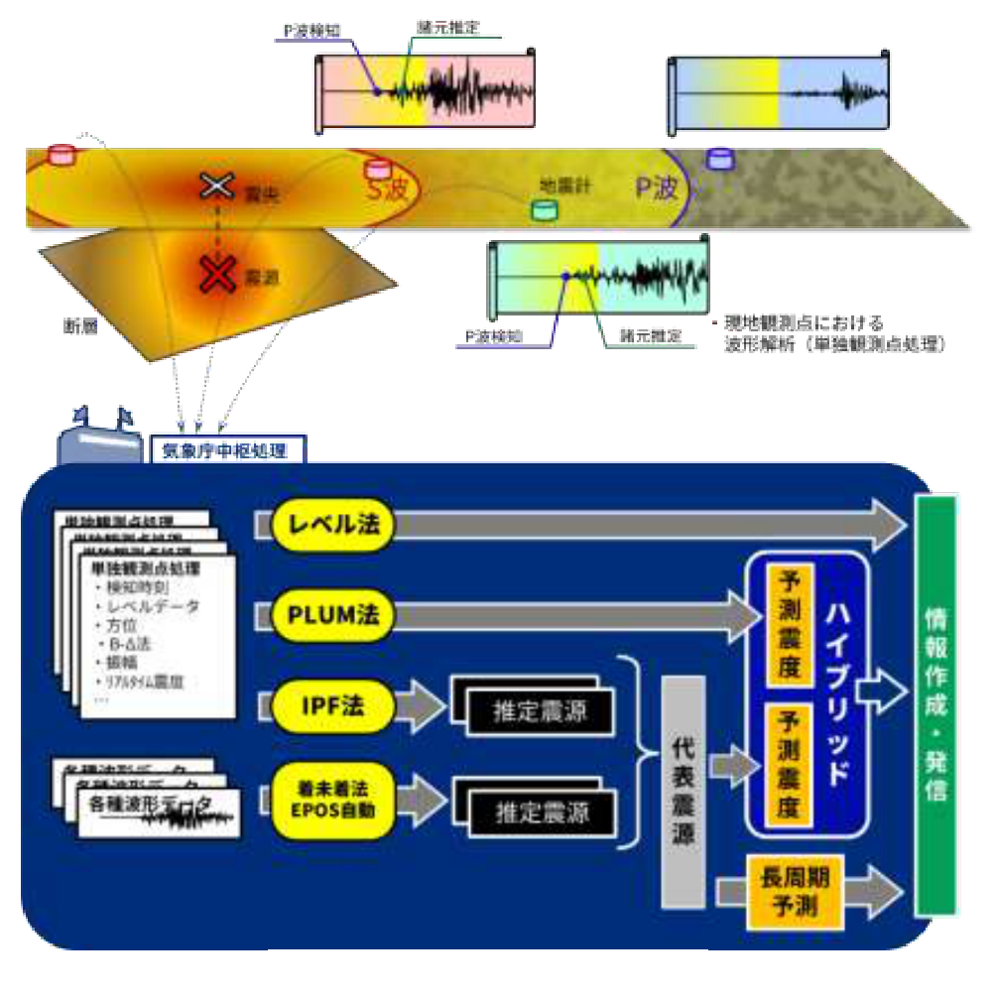{#fig-orig01 fig-alt="緊急地震速報の処理の流れを示す原資料の図1"}

*出典: 気象庁「緊急地震速報の概要や処理手法に関する技術的参考資料」（令和6年4月11日）図1（https://www.jma.go.jp/jma/kishou/know/jishin/eew/katsuyou/reference.pdf）を抜粋・トリミングのうえ掲載。気象庁ホームページの利用規約（公共データ利用規約（第1.0版）に準拠）に基づく。*

### 1.3 震度予測の二本立て

- **震源とMによる手法**: 震源位置・Mを推定し、距離減衰式（経験式）で全国の揺れを計算する。**遠くまで一括予測でき、到達時刻も出せる**のが強み。反対に、震源やMの初期誤差がそのまま予測誤差になって表れるのが弱み。
- **震源要素によらない手法（レベル法・PLUM法）**: 観測された揺れそのものを出発点にする。**早く・頑強**だが、観測点近傍・近距離にしか適用できず、到達時刻も原則出せない。
- 実運用は**ハイブリッド**: 両者を同一イベントとみなせた場合「大きい方の予測震度を採用」する。どちらか一方の過小評価をもう一方がカバーする、安全側（保守的）な設計です。

---

## 解説 2. 単独観測点処理 — 観測点側がやること

### 2.0 トリガと処理タイミング

観測点では平時から地動を監視していて、「地動がノイズレベルの定数倍を超えた」ら**トリガ**がかかり、本格処理が開始します。ここでの設計上の特徴は「**必要な処理（ノイズ識別以外）はトリガ後1秒で済ませる**」ことです。

- 検測・方位・距離・ノイズ判別 → トリガ後最初の1秒のデータで即時実行、以後毎秒結果を送信
- リアルタイム震度や最大振幅のモニタ → **トリガ有り無しに関係なく常時**実行・送信

**▼原資料 図2 — 1秒間で波形を処理するとは？**

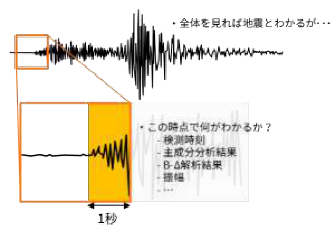{#fig-orig02 fig-alt="1秒間で波形を処理する内容を示す原資料の図2"}

*出典: 気象庁「緊急地震速報の概要や処理手法に関する技術的参考資料」図2（https://www.jma.go.jp/jma/kishou/know/jishin/eew/katsuyou/reference.pdf）を抜粋・トリミングのうえ掲載。気象庁ホームページの利用規約（公共データ利用規約（第1.0版）に準拠）に基づく。*

### 2.1 （１）自動検測・主成分分析法・B-Δ法

#### 自動検測（P波検測時刻の決定）

トリガがかかった瞬間そのものではなく、**トリガ時点から遡って「振幅がノイズレベルを超えた時刻」**を読み取り、それをP波の検測時刻とする。瞬間的なトリガ値はノイズ混入でズレやすいので、遡り検測でより正確なP波到達時刻を得ます。

#### 主成分分析（到来方位の推定）

P波は**縦波**なので、伝播方向に平行な振動をします。つまり初動1秒分の変位を南北・東西・上下の3次元空間に描くと、軌跡（パーティクルモーション）はほぼ1本の直線になります。主成分分析で**この直線の向き（主軸）**を求めれば、地震波がどちらから来たか（→震央方位）がわかります。

**▼原資料 図3 — P波初動部（変位波形）1秒間のパーティクルモーションの主軸から地震波の到来方向を求める**

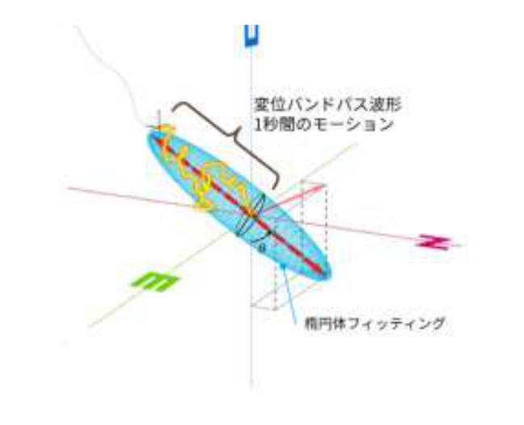{#fig-orig03 fig-alt="P波初動部のパーティクルモーションを示す原資料の図3"}

*出典: 気象庁「緊急地震速報の概要や処理手法に関する技術的参考資料」図3（https://www.jma.go.jp/jma/kishou/know/jishin/eew/katsuyou/reference.pdf）を抜粋・トリミングのうえ掲載。気象庁ホームページの利用規約（公共データ利用規約（第1.0版）に準拠）に基づく。*

#### B-Δ法（震央距離の推定）

初動1秒分の**加速度絶対値波形**（エンベロープ的増加曲線）に

$$y(t) = B\,t\,e^{-A\,t}$$

をフィッティングします。パラメータの読み方:

- **係数 B**: 立ち上がりの「鋭さ」。大きいほど急激に振幅が伸びる。
- **係数 A**: 増加が「どれだけ続くか」。小さいほど立ち上がり相が長い。

```{python}
#| label: fig-bdelta-envelope
#| echo: false
#| fig-cap: "B-Δ法でフィッティングするエンベロープ形 y(t) = B t · e^(−A t)（任意単位）。B（立ち上がりの鋭さ）に着目すると、近い地震ほど急峻になる"
#| fig-width: 6.5
#| fig-height: 3.6
t = np.linspace(0, 1.0, 500)
curves = ((0.06, 1.0, "遠い地震: B小\n→ 緩やかで長い立ち上がり"),
          (0.25, 0.8, "中距離"),
          (0.85, 0.6, "近い地震: B大\n→ 急峻で短い立ち上がり"))
fig, ax = plt.subplots()
for B, A, label in curves:
    y = B * t * np.exp(-A * t)
    ax.plot(t, y, lw=2.2)
    pk = B / (np.e * A)
    tp = 1 / A
    ax.annotate(label, (tp, pk), xytext=(tp + 0.12, pk * 1.25),
                fontsize=9, color="#3d3d3d",
                arrowprops=dict(arrowstyle="->", color="#999", lw=1))
ax.set_xlabel("トリガからの経過時間 (秒)")
ax.set_ylabel("包絡振幅（任意単位）")
ax.set_xlim(0, 1.0)
ax.set_ylim(0, 0.62)
fig.tight_layout()
```

**なぜ距離がわかるのか**: 遠い地震ほどP波のエンベロープが「緩やかで長い」立ち上がりになる（伝播の過程で波形が伸び、なまる）という経験的性質があります。束田ほか(2004)は、**係数BがMによらず震央距離Δと相関する**ことを示しました。よってBからおおよその震央距離が求められます。

**▼原資料 図4 — P波初動部（加速度絶対値波形）へ関数(1)式をフィッティングし、係数A、Bを求める**

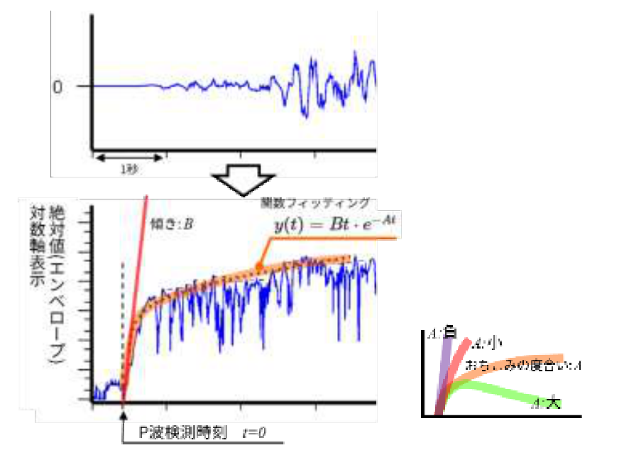{#fig-orig04 fig-alt="P波初動部への関数フィッティングを示す原資料の図4"}

*出典: 気象庁「緊急地震速報の概要や処理手法に関する技術的参考資料」図4（https://www.jma.go.jp/jma/kishou/know/jishin/eew/katsuyou/reference.pdf）を抜粋・トリミングのうえ掲載。気象庁ホームページの利用規約（公共データ利用規約（第1.0版）に準拠）に基づく。*

**▼原資料 図5 — 傾きを表す係数Bと震央距離Δの関係（束田ほか[2004]）**

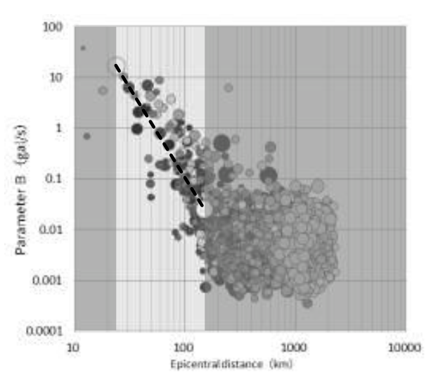{#fig-orig05 fig-alt="係数Bと震央距離の関係を示す原資料の図5"}

*出典: 気象庁「緊急地震速報の概要や処理手法に関する技術的参考資料」図5（原図の典拠: 束田ほか[2004]）（https://www.jma.go.jp/jma/kishou/know/jishin/eew/katsuyou/reference.pdf）を抜粋・トリミングのうえ掲載。気象庁ホームページの利用規約（公共データ利用規約（第1.0版）に準拠）に基づく。*

- 主成分分析 → 方位はわかる／距離はわからない
- B-Δ法 → 距離はわかる／方位はわからない

両者は単体では不完全ですが、**検測時刻も含めて組み合わせると「どの方角にいくら離れた地点」という粗い推定（1観測点だけでも）** が成立します。震源近傍で一番早くトリガする観測点1個分の情報でも発信の足がかりになるため、この冗長な組合せが意味を持ちます。

### 2.2 （２）ノイズ識別 — 8つのふるい

思想は「自然地震の波の性質に当てはまらないなら、それはノイズ」という反証方式です。

| # | 手法 | 論理 |
| --- | --- | --- |
| ① | 上下動/水平動振幅比 | 自然地震のP波部分では上下動と水平動の振幅比が一定範囲に収まる。外れたらノイズ |
| ② | データのばらつき度（移動分散） | パルス性ノイズやオフセットずれは分散が続かない。地震なら分散はより持続的に大きい |
| ③ | B-Δ法の係数A | 立ち上がった直後にすぐ落ち着くような波形（Aが大きい）は、大きな地震ではないと判断 |
| ④ | B-Δ法の係数B | 自然地震の立ち上がり速度はある範囲内に収まる。外れたらノイズ |
| ⑤ | フィッティング残差 | そもそもB-Δ法の関数形に合わない波形は、③④の判断自体が信頼できないので排除 |
| ⑥ | 加速度振幅最大値 | 一定時間待っても最大振幅が大きくならないなら、大きな地震ではない |
| ⑦ | 複数センサの照合 | 同じ場所に併設された複数センサが、**両方**トリガしたときだけ地震と認める。片方のみなら故障やノイズ |
| ⑧ | エアガン（海底地震計のみ） | 海上探査用のエアガン音は、トリガ直後に短周期成分が卓越する特徴があるのでそこで判別 |

この8種を並行して実行し、最後まで「地震」として残ったデータだけが中枢へ有効な情報として流れます。

### 2.3 （３）リアルタイム震度演算

計測震度の通常の算出手順は

1. 一定時間分の加速度波形を蓄積
2. フーリエ変換して周波数領域で震度用フィルタを適用
3. 3成分をベクトル合成
4. トリガ判定後60秒を1地震として、「ベクトル合成値が振幅a以上となる時間の合計が0.3秒になるようなa」を求める
5. `I = 2 log₁₀ a + 0.94` で震度を得る

というもので、**フーリエ変換（＝一定区間を蓄積してから計算）が入るため、リアルタイム性がない**のが問題でした。

**▼原資料 図6 — リアルタイム震度と震度（計測震度・階級震度）の算出タイミングの違い**

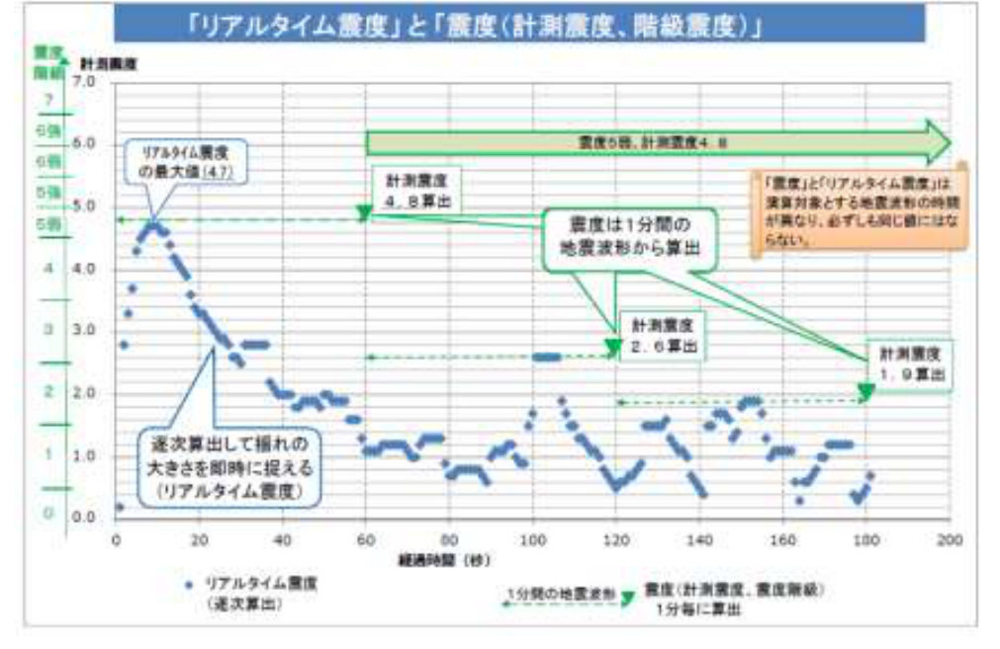{#fig-orig06 fig-alt="リアルタイム震度と震度の算出タイミングの違いを示す原資料の図6"}

*出典: 気象庁「緊急地震速報の概要や処理手法に関する技術的参考資料」図6（https://www.jma.go.jp/jma/kishou/know/jishin/eew/katsuyou/reference.pdf）を抜粋・トリミングのうえ掲載。気象庁ホームページの利用規約（公共データ利用規約（第1.0版）に準拠）に基づく。*

そこで功刀(2008)の**時間領域の漸化式フィルタ**（計算を逐次に進められる再帰型のフィルタ）を使うのが**リアルタイム震度**です。

- 毎秒、その時点での揺れの大きさを計測震度相当の値として流し続けられる
- 最大加速度など別指標からの回帰式推定より精度が高く、移動区間処理より計算量が少ない

**注意点**: リアルタイム震度は「1地震につき1つの値」の「震度」とは違い、**揺れの途中経過を示す時系列値**です。PLUM法（解説3.2）では、このリアルタイム震度が入力データとして直接使われます。

### 2.4 （４）中枢へのデータ送信

観測点から中央へ、2種類の情報路で送られます。

| 情報 | トリガとの関係 | 送信タイミング |
| --- | --- | --- |
| 検測時刻・方位・距離・振幅などの諸元 | トリガ後からトリガ終了まで | 毎秒 |
| リアルタイム震度・最大振幅 | トリガ有り無しに関係なく | 連続（常時） |
| レベルデータ（100gal超過通知） | 上下動加速度が100gal超で発信 | 発生時即 |

この100galという閾値が、レベル法（解説3.2の①）のトリガになり、震度5弱相当の情報を最速で出す仕組みにつながります。

**▼原資料 図7 — 単独観測点処理による処理結果の送信イメージ**

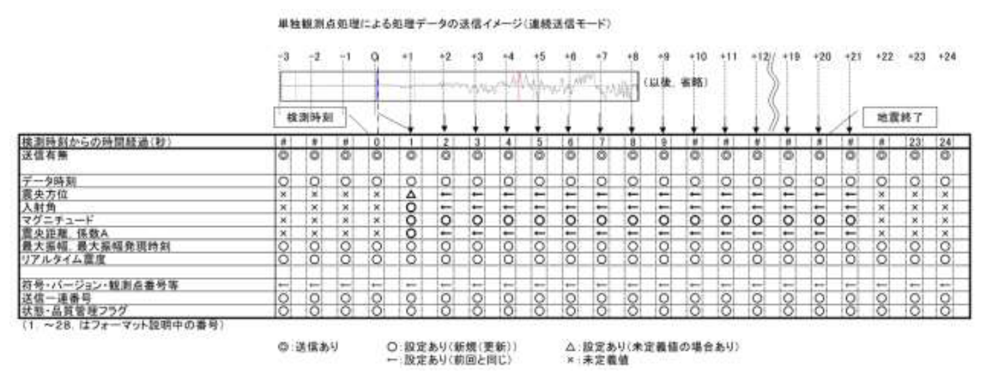{#fig-orig07 fig-alt="単独観測点処理の送信イメージを示す原資料の図7"}

*出典: 気象庁「緊急地震速報の概要や処理手法に関する技術的参考資料」図7（https://www.jma.go.jp/jma/kishou/know/jishin/eew/katsuyou/reference.pdf）を抜粋・トリミングのうえ掲載。気象庁ホームページの利用規約（公共データ利用規約（第1.0版）に準拠）に基づく。*

---

## 解説 3.1. 中枢処理 — 震源とMによる予測手法

### 3.1-①（ア）IPF法 — パーティクルフィルタによる震源決定

**思想**: 従来、検測時刻に基づくグリッドサーチやテリトリー法、B-Δ法、振幅情報は、各手法がそれぞれ独立に扱っていました。IPF法（Integrated Particle Filter法）はこれらを**すべて一括して扱い、「全体として最もデータを満足する震源」を確率的に推定**します。

**手順の概略**（溜渕ほか2014）:

1. **事前確率**: これまでの地震の発生分布（どこで・どれくらいの頻度で起きたか）を、緯度・経度・深さのグリッド上の事前確率として保持（図8 (a)）。
2. **テリトリーの確率**: ある観測点からトリガデータが届いたら、まずその観測点を含む水平テリトリー（＝その検測時刻を説明可能な震源域）とその周辺に確率分布を置く（図8 (b)）。テリトリー法は横田ほか(2002)、中村(2007)が元の考え方。
3. **事前×テリトリ―**: 両者の積で「このトリガが来たなら、震源は大体この範囲だろう」という新しい事前分布（先見的なもの）ができる（図8 (c)）。
4. **パーティクル散布**: この分布に従って多数の仮想震源（パーティクル）をランダムに配置。
5. **尤度計算**: 各パーティクルが震源だと仮定したときの理論値（来るべき検測時刻・距離・方位・振幅）と、実際の観測値の差が正規分布に従うと仮定して、一致度（尤度）を計算する。尤度が最も高いものが現時点の震源候補。
6. **リサンプリング＋摂動**: 尤度に応じた重みでパーティクルを再抽出し、微小なズレ（摂動）を加えて特定の候補に偏らないようにする。新しい観測データの入力や一定時間の経過のたびにこれを繰り返し、**震源の精度を確率論的に高めていく**。

**▼原資料 図8 — IPF法処理における事前確率の与え方（溜渕ほか[2014]より）**

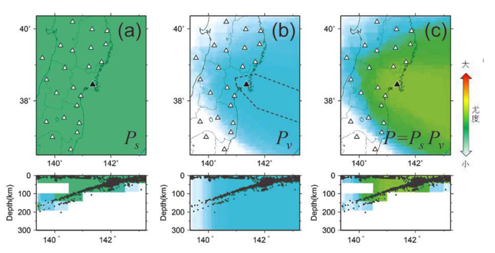{#fig-orig08 fig-alt="IPF法の事前確率の与え方を示す原資料の図8"}

*出典: 気象庁「緊急地震速報の概要や処理手法に関する技術的参考資料」図8（原図の典拠: 溜渕ほか[2014]）（https://www.jma.go.jp/jma/kishou/know/jishin/eew/katsuyou/reference.pdf）を抜粋・トリミングのうえ掲載。気象庁ホームページの利用規約（公共データ利用規約（第1.0版）に準拠）に基づく。*

**▼原資料 図9 — IPF法処理で撒かれたパーティクルとその尤度（溜渕ほか[2014]より）**

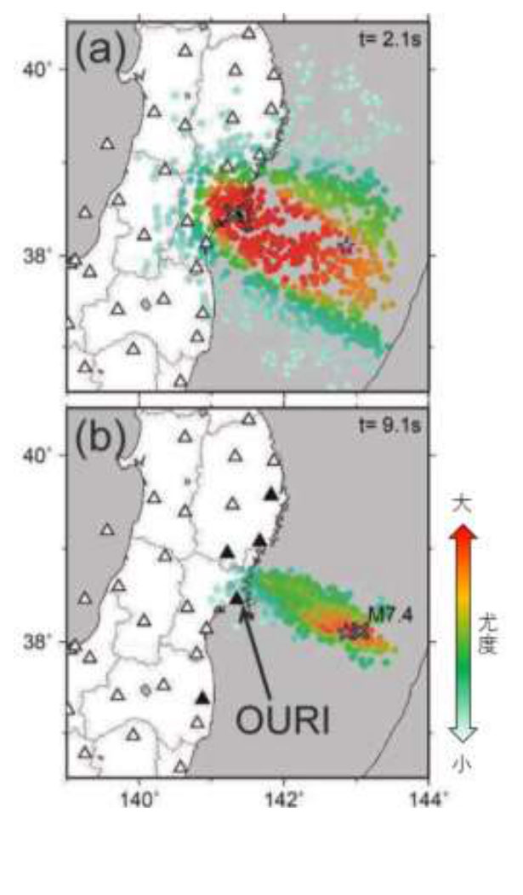{#fig-orig09 fig-alt="IPF法のパーティクルと尤度を示す原資料の図9"}

*出典: 気象庁「緊急地震速報の概要や処理手法に関する技術的参考資料」図9（原図の典拠: 溜渕ほか[2014]）（https://www.jma.go.jp/jma/kishou/know/jishin/eew/katsuyou/reference.pdf）を抜粋・トリミングのうえ掲載。気象庁ホームページの利用規約（公共データ利用規約（第1.0版）に準拠）に基づく。*

**複数地震識別への応用が特徴的**: 新しい観測データが来たとき、その検測時刻と振幅が既存の仮想震源群で説明できる範囲（重み付き誤差が許容範囲）を外れていたら「**別の地震が発生した**」と判定する。従来は検測時刻だけで複数地震を判別していたのに対し、**振幅の情報も加えたことで、検測時刻が偶然重なった同時多発地震などもより確実に識別できる**ようになっています。

### 3.1-①（イ）着未着法 — 「まだ揺れていない」ことすら情報にする

防災科研Hi-net（高密度の全国地震観測網）のデータを用いるグリッドサーチ系手法（Horiuchi et al. 2005）。

- **着状態**: 振幅が短期的に変化した＝地震波が到達したとみられる観測点
- **未着状態**: まだ波形に変化がない観測点

ポイントは**「未着」の観測点も情報として使う**ことです。「この観測点にまだ波が届いていない」という事実は、「震源はこの地点を説明できる位置には存在しない」という否定的な制約として、震源決定の精度改善に寄与します。

- 周辺2地点以上が「着状態」になったとき震源決定処理を開始。
- 「着」の観測点の検測時刻と、周辺グリッドに置いた仮想震源群の理論走時の差（残差）が小さくなるよう、グリッドを徐々に移動させつつ間隔を狭めて収束させ、最終的な推定震源とする。

**▼原資料 図10 — 着未着法の概念図（図は2地点時）**

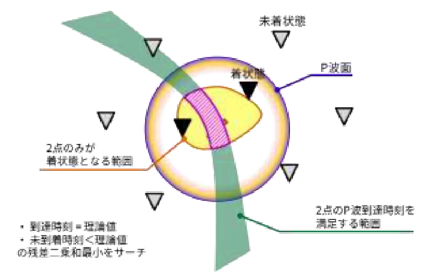{#fig-orig10 fig-alt="着未着法の概念図を示す原資料の図10"}

*出典: 気象庁「緊急地震速報の概要や処理手法に関する技術的参考資料」図10（原図の典拠: Horiuchi et al.[2005]）（https://www.jma.go.jp/jma/kishou/know/jishin/eew/katsuyou/reference.pdf）を抜粋・トリミングのうえ掲載。気象庁ホームページの利用規約（公共データ利用規約（第1.0版）に準拠）に基づく。*

**気象庁網とHi-netの共存**: 緊急地震速報は基本、気象庁の多機能型地震計網で処理しますが、着未着法だけはHi-net網のデータを使います。両網は観測点密度・センサ特性・保守方針などが異なりますが、**それぞれの長所が活きる形で併用**することで、システム全体として速さと高密度の両方の利益を取っています。

### 3.1-①（ウ）EPOSによる自動処理手法

気象庁の既存システムEPOS（地震活動等総合監視システム）による自動震源処理です。

- 波形データを中央に集め、地震検知（トリガ判定）→ P/S波の到達時刻と最大振幅を自動検測 → 震源を決定
- **遅い理由**: 複数観測点の振幅変化が起きてからでないと処理が始まらず、さらに**S波の到達も待つ**ため
- **正確な理由**: **S波到達時刻も震源決定に使える**ので、P波のみの即時処理より精度が高い

役割としては「**速いが粗い**緊急地震速報独自の処理」に対する「**遅いが正確な**サブシステム」であり、即時の震源推定が難しい局面（同時多発地震など）で精度の高い追認を与える裏支えです。

### 3.1-② マグニチュード計算方法 — なぜ式を3種類も用意するのか

**問題**: 標準的な気象庁Mの定義は「地震波全体の最大振幅」を使うもの。**S波が届いて初めて計算が完成する**ため、そのままでは速報に耐えません。

**解決**: 時間帯によって2種類の式を切替えます。

- **P波M**（明田川ほか2010）— P波部分だけで推定するM:
  $$0.72\,M = \log_{10} A + 1.2\,\log_{10} R + 5.0\times10^{-4}\,R - 5.0\times10^{-3}\,D + 0.46$$
- **全相M**（清本ほか2010）— S波以降を含む全振幅から推定するM:
  $$0.87\,M = \log_{10} A + 1.0\,\log_{10} R + 1.9\times10^{-3}\,R - 5.0\times10^{-3}\,D + 0.98$$

**式の読み方（共通）**:

- **A**: 3成分合成最大変位振幅（単位: $10\,\mu\mathrm{m} = 10^{-5}\,\mathrm{m} = 0.01\,\mathrm{mm}$。原資料・reference.mdには単位の明示がないが、P波M式（明田川ほか2010）・全相M式（清本ほか2010）の原論文の定義による）
- **R**: 震源距離（km）
- **D**: 震源の深さ（km）
- 左辺の係数（0.72や0.87）は $M$ と $\log_{10}A$ の関係の回帰係数（傾きの逆数相当）。**$\log_{10}R$ の係数（1.2／1.0）は幾何減衰の強さ**、$5.0\times10^{-4}R$ や $1.9\times10^{-3}R$ は非弾性減衰等の距離に比例した減衰、$-5.0\times10^{-3}D$ は深さに関する補正を表します。
- P波Mは**初期（S波到達前）に使えるが、最大振幅が見えきる前なので過小評価しやすい**。全相Mは**安定するが、S波が届いてからでないと使えない**。

**図11に示された2つの事例の対比が本質**:

- **十勝沖地震型**: 最大振幅が、理論S波到達時刻の**約15秒後**まで現れない型。理論S波時刻で式を切替えると、最大振幅が現れる前の間、Mを小さく見積もってしまう。
- **紀伊半島南東沖地震型**: 理論走時よりも**前に**最大振幅が現れる型。理論S波時刻までP波Mを使い続けると、Mを過大に見積もってしまう。

**▼原資料 図11 — 3成分合成変位Mの時間推移と理論S波到達時刻との比較**

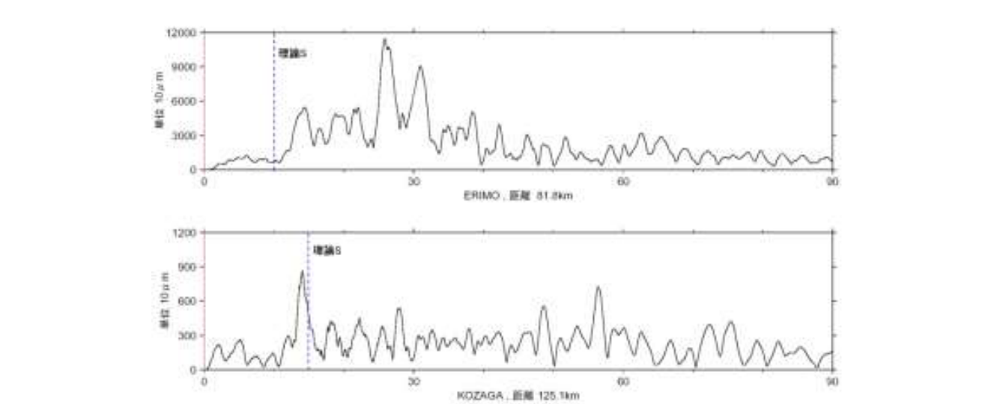{#fig-orig11 fig-alt="3成分合成変位Mの時間推移を示す原資料の図11"}

上図は平成15年（2003年）十勝沖地震の際のえりも観測点の3成分合成変位振幅（最大振幅が理論S波到達時刻の約15秒後に発現）、下図は平成16年9月5日の紀伊半島南東沖地震の和歌山古座川観測点の3成分合成振幅（理論走時より前に最大振幅が発現）。原資料の説明を要約。

*出典: 気象庁「緊急地震速報の概要や処理手法に関する技術的参考資料」図11（https://www.jma.go.jp/jma/kishou/know/jishin/eew/katsuyou/reference.pdf）を抜粋・トリミングのうえ掲載。気象庁ホームページの利用規約（公共データ利用規約（第1.0版）に準拠）に基づく。*

**対策（固定M）のロジック**:

1. P波検知後、**3秒後の最大振幅**からP波Mを初回計算（以後は毎秒更新）。
2. **理論S波到達時刻の70%まではP波M**を使う。
3. 以降は全相Mに切替える。ただし**「固定M」**: P波期間の最大振幅から得られたMを一定時間保持し、全相Mがそれを超えるまで使う（この連続保持により、Mが突然に小さく跳ね下がるのを防ぐ）。
4. 全相Mが固定Mを超えない場合でも、S波理論到達時刻から「固定Mから算出した破壊継続時間（＝このMの地震の揺れが続くはずの時間）」または「P波検知からP波部分の最大振幅が発現するまでの時間」のいずれかを経過したら、強制的に全相Mへ切替える。

要するに「**Mの表示は急には下がらない**」という挙動を制御する仕組みです。速報値として一度大きなMを示した後にいきなり下げ続けるのは利用者側で混乱を招くため、発信情報の安定性を優先しています。

```{python}
#| label: fig-fixed-m-honor
#| echo: false
#| fig-cap: "固定M機構のイメージ（数値は模式値）。発表M（太線）は P波M → 固定Mで保持 → 全相Mへ切替える"
#| fig-width: 6.5
#| fig-height: 3.8
t = np.linspace(0, 60, 600)
Ts, T70 = 20.0, 14.0             # 理論S波到達時刻 と その70%
def m_all(ti):                   # 全相M: S波到達後に risen、やがて真値へ
    return 5.9 + 0.55 * np.clip((ti - Ts) / 25.0, 0, 1) if ti >= Ts else np.nan
def m_p(ti):                     # P波M: 最大振幅未確定で過小気味に上昇
    return 5.4 + 0.9 * np.clip((ti - 3.0) / 40.0, 0, 1) if ti >= 3 else np.nan
M_FIXED, T_FORCE = 6.6, 35.0     # 固定M と 強制切替時刻
m_pub = np.array([np.nan if ti < 3 else
                  m_p(ti) if ti < T70 else
                  M_FIXED if ti < Ts else
                  M_FIXED if ti < T_FORCE else m_all(ti) for ti in t])

fig, ax = plt.subplots()
ax.plot(t, [m_p(ti) for ti in t], color="#888", lw=1.3, ls="--", label="P波M（推定値）")
ax.plot(t, [m_all(ti) for ti in t], color="#2a9d8f", lw=1.3, ls="-.", label="全相M（推定値）")
ax.plot(t, m_pub, color="#d62728", lw=3.2, label="発表M（固定M機構適用）")
notes = ((3, 5.55, "P波Mを使う\n（過小評価気味）"),
         (14.5, 6.68, "固定Mで保持"),
         (36, 6.62, "強制切替→全相Mへ"))
for xt, yt, label in notes:
    ax.annotate(label, (xt, yt), fontsize=9, color="#3d3d3d")
ax.axvline(Ts, color="#555", ls=":", lw=1.2)
ax.text(Ts, 5.05, "理論S波到達時刻", fontsize=9, color="#555", ha="center")
ax.set_xlabel("P波検知からの経過時間 (秒)")
ax.set_ylabel("マグニチュード（模式値）")
ax.set_xlim(0, 60)
ax.set_ylim(5.0, 6.9)
ax.legend(loc="lower right", fontsize=9)
fig.tight_layout()
```

**海底地震計（OBS）向けの上下動変位M**（林元ほか2019）:

$$0.90\,M = \log_{10} A + 0.83\,\log_{10} R + 1.7\times10^{-3}\,R - 2.6\times10^{-3}\,D + 1.68$$

ここでの **A は上下動変位振幅（単位: $10\,\mu\mathrm{m}$。林元ほか2019の定義による）**。OBSは:

- 設置環境の地震波増幅の影響や、地震時の**姿勢角変化**により、過大な振幅が混入しやすい
- 3成分合成ではその影響が避けられない

という理由から、**（i）上下動変位振幅だけを使う**、**（ii）複数観測点の振幅データが揃うまで待つ**、**（iii）観測点Mが上位のデータは異常値の可能性が高いので、M計算から除外する**という追加の保守処理を行っています。

### 3.1-③ 震源・Mの品質管理処理（近傍M）

推定した震源とMは、**推定した震源の近傍の観測点（最大3地点）の振幅から計算した「近傍M」**と比較して管理されます。

- **近傍M**: 推定震源の近くの観測点が実際に揺れた程度から逆算した、その地域でのM相当値
- **判定**: 近傍Mが震源のMに対して一定以上小さい場合、**「この震源位置やMは不適切」と判断し、震源とMを更新しない（棄却）**

なぜこれが効くか。図12に説明されているシナリオです:

- P波検知した観測点のデータから、震源が真の位置から大きく外れて決定されたとする。
- その場合、トリガした観測点の振幅でMを評価すると、**観測点が仮定の震源に比べて異常に近い（あるいは異常に遠い）状態になり、Mの推定が過大（または過小）に偏る**。
- 一方、**トリガに頼らず推定震源の近傍の観測点の最大3地点**の振幅で評価（近傍M）すると、真の震源からの揺れがまだその場所に到達していないことも反映でき、より適切なMが出る。
- 推定Mと近傍Mの乖離が大きい場合、震源を「棄却」する。

**▼原資料 図12 — 近傍Mの推定模式図**

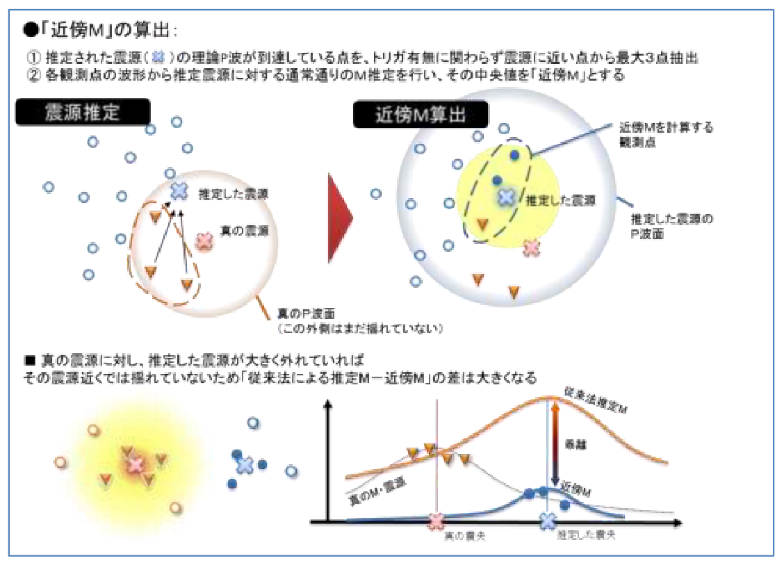{#fig-orig12 fig-alt="近傍Mの推定模式図を示す原資料の図12"}

トリガの得られた観測点（赤の▽）で推定した震源（青の×）が真の震源（赤の×）から外れた場合の、推定Mの過大評価と近傍M（推定震源近傍の最大3地点の振幅による評価）の乖離を説明する模式図。原資料の説明を要約。

*出典: 気象庁「緊急地震速報の概要や処理手法に関する技術的参考資料」図12（https://www.jma.go.jp/jma/kishou/know/jishin/eew/katsuyou/reference.pdf）を抜粋・トリミングのうえ掲載。気象庁ホームページの利用規約（公共データ利用規約（第1.0版）に準拠）に基づく。*

**PLUM法との関係**: この棄却処理が現実的に機能するようになった背景には「揺れから揺れを予測するPLUM法による予測で情報発表ができるようになったこと」があります。つまり、震源とMに基づく予測ができない、あるいは不満足な状態でも、PLUM法による観測ベースの発表が可能になった分、粗悪な震源を無理に使わず棄却できる**システム的なゆとり**が生まれています。

**付帯処理**: 地震計の異常や機器ノイズで**地震学的にあり得ないほど過大な変位振幅**を観測した場合、そのデータを使用しない（M推定から除外する）処理も実装されています。これらは「1地点の観測結果だけで過大な予測震度を発表してしまう事態」を防ぐ安全機構です。

### 3.1-④ 予測震度および主要動到達予測時刻算出処理

**▼原資料 図13 — 予測震度算出の流れ**

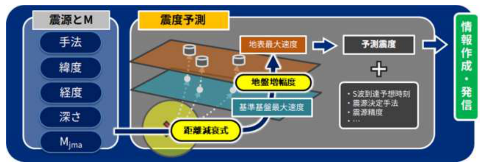{#fig-orig13 fig-alt="予測震度算出の流れを示す原資料の図13"}

*出典: 気象庁「緊急地震速報の概要や処理手法に関する技術的参考資料」図13（https://www.jma.go.jp/jma/kishou/know/jishin/eew/katsuyou/reference.pdf）を抜粋・トリミングのうえ掲載。気象庁ホームページの利用規約（公共データ利用規約（第1.0版）に準拠）に基づく。*

#### （ア）入力処理

- **予測震度算出の入力**: 震源（緯度・経度・深さ）＋M＋地盤増幅度
- **主要動（S波）到達予測時刻算出の入力**: 震源＋地震の発生時刻
- **レベル法だけは例外**: あらかじめ設定した閾値を超えた場合の最大振幅（加速度値）を入力とする場合がある

#### （イ）予測震度算出処理 — 5つの段階を通る数式ストリーム

##### （1）Mjma → Mw変換

$$M_\mathrm{w} = M_\mathrm{jma} - 0.171$$

- **理由**: 後続の距離減衰式は**モーメントマグニチュード Mw**（エネルギー規模）を対象に作られています。気象庁M（Mjma）は振幅ベースの別系統の規模尺度なので、まずこの換算が必要です。
- **換算式の由来**: 宇津(1982)・宇津(1977)・佐藤(1989)によるM間の関係式。
- **注意**: この単純シフトは近似であり、特に大地震ではMjmaが飽和することで、正確なMwとはズレます。ただしEEWの運用ではこのシフトを標準処理としています。

##### （2）最短距離の計算（相似則→断層球）

$$\log_{10} L = 0.5\,M - 1.85$$

ここで $L$ は断層長（km）、$M$ はマグニチュード（宇津1977）。原資料のとおり、ここでの $M$ は処理上 $M_\mathrm{w}$ とみなしている。

- **意味**: 断層の長さLはマグニチュードMの対数に比例する、という地震学の「**相似則**」です。Mが1大きくなると断層長は約10^0.5 ≒ 3.2倍になる。
- **運用**: このLから、**震源を中心とし半径 L/2 の球**を想定し、予測地点までの距離は**その球面からの最短距離**として入力する（図14）。
- **なぜか**: 標準的な距離減衰式は点震源を仮定していますが、大地震の破壊域は広がりを持つ点、そして**速報の時点で正確な断層形状（走向・破壊過程）は確定できない**からです。球体近似は情報の少ない段階での**安全側**の保守的近似になっています。
- **補足**: ここでの「深さ0km」は震源の深さではなく**予測地点側の基盤深度**を指す。原資料（reference.md 3.（１）④イ「最短距離の計算」：「基盤深度については深さ0kmとして計算している」）に対応し、基準基盤（S波速度600m/s層）が地表面にあるとみなして最短距離を計算する運用を意味する。震源の深さ $D$ は三次元距離や司・翠川式の深さ補正項（$0.0038D$）にはそのまま代入される。また距離には**3kmの下限**を設け（震源に直上の観測点で式が異常に跳ねるのを防ぐ）、震源からの距離が3km未満の観測点は一律3kmに設定。
- **点震源想定との関係**: 原資料では「情報発表内容に応じて点震源想定の単純な震源距離での計算も採用している」とされる。具体的な使い分けとして、発表パターン3（reference.md 4.（２）電文）では点震源想定での予測値を下限、断層長（L/2）考慮による予測値を上限として「震度○○から○○」と幅付きで表現する。

**▼原資料 図14 — 最短距離の計算方法**

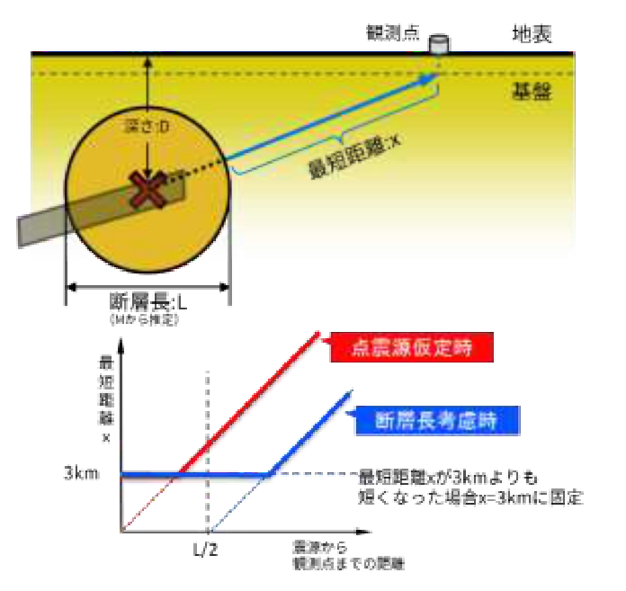{#fig-orig14 fig-alt="最短距離の計算方法を示す原資料の図14"}

*出典: 気象庁「緊急地震速報の概要や処理手法に関する技術的参考資料」図14（https://www.jma.go.jp/jma/kishou/know/jishin/eew/katsuyou/reference.pdf）を抜粋・トリミングのうえ掲載。気象庁ホームページの利用規約（公共データ利用規約（第1.0版）に準拠）に基づく。*

##### （3）基準基盤での最大速度の推定（司・翠川1999の距離減衰式）

$$\log_{10}(\mathrm{PGV600}) = 0.58\,M_\mathrm{w} + 0.0038\,D - 1.29 - \log_{10}\!\left(x + 0.0028 \times 10^{0.50\,M_\mathrm{w}}\right) - 0.002\,x$$

**各項の読み方**:

| 項 | 意味 |
| --- | --- |
| 0.58 Mw | 規模項。$M_\mathrm{w}$ が1大きくなると $10^{0.58} \simeq 3.8$ 倍（$0.1$ 大きくなると約 $1.14$ 倍）増える寄与 |
| 0.0038 D − 1.29 | 深さ補正項＋定数項（経験式の回帰による系統補正。係数が正のため、式上は深いほどPGV600はやや大きく評価される） |
| −log₁₀(x + 0.0028 × 10^(0.50Mw)) | **距離項**。xは断層球面からの最短距離（km）、`10^(0.50Mw)` は大地震ほど「破壊域半径相当」を距離に追加する形で**近傍の飽和を表現する効果**を持つ |
| −0.002 x | 距離に比例した減衰（非弾性減衰などの遠距離損失） |

ここで**PGV600**は、S波速度 **600m/s の硬質地盤（基準基盤）** での最大速度（cm/s、水平動2成分のうち大きい方）。すべての地点をまずこの共通の硬質地盤上に「置き換えて」比較するのがこの手順のアイデアです。

※司・翠川（1999）の原式には断層タイプ別の係数（プレート間 −0.02、プレート内 ＋0.12、地殻内 0.00）が含まれるが、本処理の式（reference.md記載式）にはその項がなく、速報時点では断層タイプを特定できないため地殻内地震（$d=0$）相当として扱っている。

##### （4）基準基盤（600m/s）→ 工学的基盤（700m/s）への換算

松岡・翠川(1994)の速度増幅度計算式：

$$\log_{10}(A_\mathrm{Rv}) = 1.83 - 0.66\,\log_{10}(A_\mathrm{Vs}) \pm 0.16 \qquad (100 < A_\mathrm{Vs} < 1500)$$

- **A_Rv**: 地表から地下30mまでの速度増幅度（＝表層地盤で最大速度が何倍になるか）
- **A_Vs**: 地下30mまでの平均S波速度。小さい（＝軟弱な地盤）ほど増幅が大きい。
- この式は速度増幅度の計算に必要な基盤の定義として**S波速度700m/sの工学的基盤**を前提にしたものです。現在の処理では、基準基盤（600m/s）上のPGV600を `0.90 = (600/700)^0.66` 倍して**工学的基盤（700m/s）上の推定最大速度 PGV700** に変換してから、次のステップへ進みます。

##### （5）地表での最大速度の推定

国土数値情報（1kmメッシュ）の地盤増幅度（速度増幅度）を掛けます。

$$\mathrm{PGVs} = A_\mathrm{Rv700} \times \mathrm{PGV700} \;\simeq\; A_\mathrm{Rv700} \times 0.90 \times \mathrm{PGV600}$$

- **A_Rv700**: S波速度700m/sの工学的基盤から地表への速度増幅度
- **対象地点が気象庁観測点で観測データが十分にある場合**: この A_Rv700 の代わりに、**Iwakiri et al.(2011)** に基づいて算出された**観測点補正係数（震度予測補正係数）**を用いる。これは各観測点の実際の観測記録から経験的に得た増幅特性で、一般の国土数値情報の値より観測点単位の精度が高い。

**▼原資料 図15 — 最大速度の工学的基盤及び地表への変換**

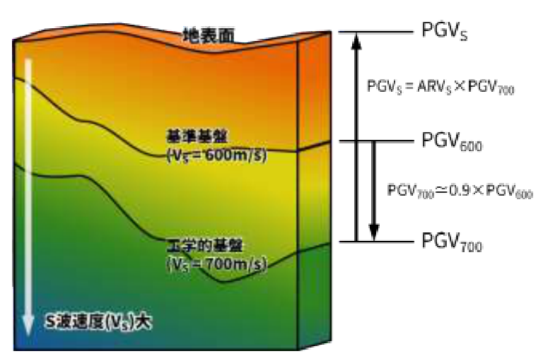{#fig-orig15 fig-alt="最大速度の変換を示す原資料の図15"}

*出典: 気象庁「緊急地震速報の概要や処理手法に関する技術的参考資料」図15（https://www.jma.go.jp/jma/kishou/know/jishin/eew/katsuyou/reference.pdf）を抜粋・トリミングのうえ掲載。気象庁ホームページの利用規約（公共データ利用規約（第1.0版）に準拠）に基づく。*

##### （6）最大速度 → 計測震度への換算（翠川ほか1999）

$$I_\mathrm{INSTR} = 2.68 + 1.72\,\log_{10}(\mathrm{PGVs}) \pm 0.21$$

ここで $I_\mathrm{INSTR}$ は推定計測震度、PGVs は地表の推定最大速度（cm/s）。適用範囲は $I_\mathrm{INSTR}$ = 4〜7。

- **読み方**: 最大速度が10倍になるごとに、計測震度は約1.72階級上がる。
- **±0.21**: この回帰式の標準偏差。震度の予測に誤差がつきまとうことを示しています。
- **適用範囲の制限**: **この式は計測震度4〜7を対象にした換算**。震度4未満の小揺れへの外挿には適していない（EEWの目的は災害をもたらす揺れの予測なので、この範囲であれば十分）。

```{python}
#| label: fig-pgv-intensity
#| echo: false
#| fig-cap: "最大速度 → 計測震度の換算（翠川ほか1999）。帯は回帰式の標準偏差 ±0.21、網掛けは式の適用範囲（計測震度4〜7）"
#| fig-width: 6.5
#| fig-height: 3.9
pgv = np.logspace(-2, 3.3, 400)
Ival = seismic_intensity(pgv)
fig, ax = plt.subplots()
ax.plot(pgv, Ival, color="#0b5cab", lw=2.2, label="換算式")
ax.fill_between(pgv, Ival - 0.21, Ival + 0.21, color="#0b5cab", alpha=0.15, label="±0.21（標準偏差）")
ax.axvspan(pgv_for_intensity(4.0), pgv_for_intensity(7.0), color="#fc8d62", alpha=0.12, label="適用範囲（震度4〜7）")
marks = ((4, "震度4"), (4.5, "震度5弱\n（警報相当）"), (5, "震度5"), (6, "震度6"), (7, "震度7"))
for Iv, lbl in marks:
    xv = pgv_for_intensity(Iv)
    ax.axvline(xv, color="#d62728" if Iv == 4.5 else "#999", ls=":" if Iv == 4.5 else "--", lw=1.0)
    ax.annotate(lbl, (xv, Iv - 0.55), fontsize=9, ha="center", color="#3d3d3d")
ax.set_xscale("log")
ax.set_xlim(1e-2, 6e3)
ax.set_ylim(2.4, 7.3)
ax.set_xlabel("地表の最大速度 PGVs (cm/s) — 対数軸")
ax.set_ylabel("計測震度 I_INSTR")
ax.legend(loc="upper left", fontsize=9)
fig.tight_layout()
```

##### （7）震源深さ150kmの制限

司・翠川(1999)式は**約50km以浅の地震**を対象にして決定された経験式です。深発地震（深発＆超深発）にそのまま適用すると最大速度が過大に計算されます。

そこで**運用上、震源深さが150kmより深い場合は震度を予測しない**ようにしています。深発地震でも、以下のような例で震度5弱以上の揺れを観測した実例はあります。

- 2014年5月5日 伊豆大島近海の地震（深さ156km, M6.0, 最大震度5弱）
- 2015年5月30日 小笠原諸島西方沖の地震（深さ681km, M8.1, 最大震度5強）

しかし、一般的にはこの範囲の深さの地震で大被害になる場合は少なく、**式の適用範囲を超える予測リスクを避ける**方向に倒しています。

#### （ウ）主要動到達予測時刻算出処理

- 気象庁で使用している速度構造 **JMA2001** に基づいて作られた**走時表**（深さ・震央距離ごとの波の到達時間テーブル）を使う
- 対象地点ごとに**S波の到達予測時刻**を計算し、それを「**主要動到達時刻**」として発表に組み込む
- 震源に対する地点の幾何学配置からS波がいつ来るかを、あらかじめ用意された走時表で引いてくるシンプルな手順

### 3.1-⑤ 長周期地震動階級の予測手法

**長周期地震動とは**: 周期が1.6秒〜7.8秒程度の長い揺れ。基本的に高層建物・橋梁・産業設備など**背の高い構造物**が共振しやすい周期帯です。特徴は:

1. **距離減衰が短周期の揺れより緩やか**で、遠くまで伝わる
2. **深部地盤構造**（堆積盆地の形状など）により、場所によっては特定の周期が選択的に増幅しやすい
3. 震度とは別物で、**階級1〜4**で表現される

#### （1）予測の基本式（Sva距離減衰式）

防災科研が開発した**絶対速度応答スペクトル（Sva）距離減衰式**（Dhakal et al.2015）を利用します。

$$\log_{10}\,\mathrm{Sva}(T) = c(T) + a(T)\,M_\mathrm{j} - \log_{10} R - b(T)\,R + \mathrm{siteFactor}(T)$$

- **T**: 周期（0.2秒きざみで評価、主に1.6〜7.8秒の帯域）
- **Sva(T)**: 周期Tでの絶対速度応答スペクトル（構造物が感じる揺れのインパクト指標）
- **c(T)**: 周期Tごとの基準値（定数）
- **a(T)**: Mjに対する回帰係数
- **b(T)**: 非弾性減衰を表す回帰係数
- **siteFactor(T)**: 各地点の地盤による補正係数

**▼原資料 図16 — 長周期地震動の予測手法概要と気象庁が用いる予測式**

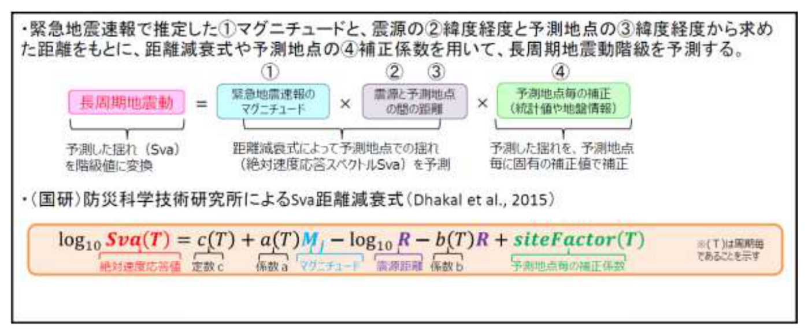{#fig-orig16 fig-alt="長周期地震動の予測手法概要を示す原資料の図16"}

*出典: 気象庁「緊急地震速報の概要や処理手法に関する技術的参考資料」図16（原図の典拠: Dhakal et al.(2015)）（https://www.jma.go.jp/jma/kishou/know/jishin/eew/katsuyou/reference.pdf）を抜粋・トリミングのうえ掲載。気象庁ホームページの利用規約（公共データ利用規約（第1.0版）に準拠）に基づく。*

#### （2）siteFactor(T) の2種類の取り方

- **方法A（統計的）**: 実際の顕著な地震イベントの観測記録から、観測点ごとに求めた統計的補正係数（最も実データに近い）
- **方法B（地盤情報）**: 防災科研地震ハザードステーションのデータから得た **S波速度1.3km/s層下面の深さ** と **地下30mまでの平均S波速度（表層の平均S波速度）** から算出する補正係数（データ不足の地域における代替手段）。原資料p.15–16およびreference.mdの記載（「S波速度1.3km/s層下面の深さ、及び地下30mまでの表層における平均S波速度」）に忠実な表記である。

過去の検証では方法Aの方が予測適合度が高かったので、**方法Aが得られる予測地点ではAを、得られない地域ではBを採用**するという優先順位付き運用。

**▼原資料 図17 — 予測地点ごとの補正係数の求め方**

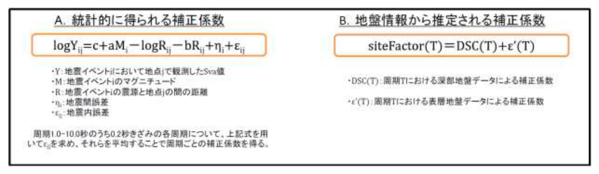{#fig-orig17 fig-alt="予測地点ごとの補正係数の求め方を示す原資料の図17"}

*出典: 気象庁「緊急地震速報の概要や処理手法に関する技術的参考資料」図17（原図の典拠: Dhakal et al.(2015)）（https://www.jma.go.jp/jma/kishou/know/jishin/eew/katsuyou/reference.pdf）を抜粋・トリミングのうえ掲載。気象庁ホームページの利用規約（公共データ利用規約（第1.0版）に準拠）に基づく。*

#### （3）長周期地震動階級の判定

周期1.6〜7.8秒の帯域で長周期地震動階級を予測する手順:

1. 各周期（1.6〜7.8秒を**0.2秒きざみ**で評価）ごとにSva(T)を計算
2. **最大値 maxSva** を求める
3. **maxSvaに補正を加えた値（Sva）** を用いて階級を判定（0.2秒きざみのサンプリングで、真の最大値が若干取りこぼされる可能性を補正）

**表1（階級の定義）**:

| 長周期地震動階級 | Sva値 |
| --- | --- |
| 1 | 5 cm/s ≦ Sva ＜ 15 cm/s |
| 2 | 15 cm/s ≦ Sva ＜ 50 cm/s |
| 3 | 50 cm/s ≦ Sva ＜ 100 cm/s |
| 4 | 100 cm/s ≦ Sva |

（対数的に見ると、階級1つ上がるごとにSvaは約3倍というスケールの階級。）

```{python}
#| label: fig-lev-bands
#| echo: false
#| fig-cap: "長周期地震動階級のSva閾値（対数スケール）。階級1つ上がるごとにSvaは約3倍になる"
#| fig-width: 6.5
#| fig-height: 3.3
fig, ax = plt.subplots(figsize=(6.5, 3.0))
bands = ((3, 5, "#f1faee", "階級0（該当なし）"),
         (5, 15, "#a8dadc", "階級1"),
         (15, 50, "#ffd166", "階級2"),
         (50, 100, "#ef8354", "階級3"),
         (100, 300, "#e63946", "階級4"))
for lo, hi, c, lbl in bands:
    ax.axhspan(lo, hi, color=c, alpha=0.55)
    ax.text(1.05, np.sqrt(lo * hi), lbl, fontsize=11, va="center", color="#1d3557")
for v in (5, 15, 50, 100):
    ax.axhline(v, color="#666", lw=0.8, ls="--")
    ax.text(0.02, v * 1.06, f"{v} cm/s", fontsize=8.5, color="#555")
ax.set_yscale("log")
ax.set_ylim(3, 300)
ax.set_xlim(0, 1.2)
ax.set_xlabel("（周期帯 1.6〜7.8 秒で階級判定）")
ax.set_ylabel("Sva (cm/s) — 対数軸")
ax.set_xticks([])
fig.tight_layout()
```

#### （4）長周期地震動予測の発表条件

長周期地震動の予測精度は、震源とMの精度に大きく依存するので**発表に踏み切る条件が厳しく設定**されています。

- **M決定に係る観測点数が3地点以上**、または**地震検知から15秒経過**した時点以降の緊急地震速報震源 を利用する（気象庁地震火山部2017）
- **深さ150km以浅の地震**を対象に予測（150km以深は広く検証済みデータがなく、予測適合度が低下するため）

---

## 解説 3.2. 震源要素によらない予測手法

### 3.2-0 前段の理論的整理 — 本手法が必要な理由

地震動は理論上、3つの特性の掛け合わせで決まります。

1. **震源特性**: どこで・どんな向きに・どんな強さで破壊が始まり進んだか
2. **伝播経路特性**: 波が地殻のどの経路をどう減衰しながら伝わったか
3. **サイト特性**: その地点の地盤がどんな増幅をするか

「震源とM による手法」は、取得済み観測データを**一旦震源へと遡って**、1と2を経験式で平均化し、任意の地点の3を掛け合わせて揺れを計算します。

**その弱点は、次の3つ**:

1. **初期データが少ない**（例えば地震直後のごくわずかなP波データの段階）だと、震源とMが誤差を含むので、そこから算出される震度予測も誤差を増幅する
2. **大地震の震源域は時間とともに広がる**。破壊がどの方向に進むか（**輻射異方性**）で揺れの方向性が変わるため、破壊情報なしに一括の経験式で近似的に表現することには限界がある
3. **同時多発地震**では検測が混乱し、震源決定そのものが正しくできない。すると速報が出せない

**その場合の退路**＝「**観測された揺れそのものを出発点にする**」手法です。観測地点と予測地点の距離が十分近ければ、1と2の平均化が必要なくなり、**経験式の精度に依存しない直接予測**が可能になります。

### 3.2-① レベル法

**発想**: 観測点1つで大きな揺れを検知したなら、**その近傍ではすでに強い揺れが発生している**。それを伝えるのが最速の情報。

- 単独観測点処理のレベルデータ（上下動加速度**100gal超**）を受け取った時点で、**震源決定や周辺の震度予測を待たずに**「その観測点の近傍で震度5弱以上の揺れ」として即座に情報を発表する。
- **図18に記載の背景**: 計測震度4.5（＝震度5弱）に対応する最大加速度振幅は、図からおよそ100gal以上であることがわかる。だから「100gal超」を「震度5弱相当の揺れ」の代替指標にしている。
- **限界**:
  - 地震との因果関係がわからない（交通事故や落雷などでも可能性があるし、それがどこで起きたかも近傍以外はわからない）
  - **最も早いが、最も信頼性の低い情報**
- **重複防止**: 「観測された振幅レベルに対応するような情報発表」がすでに行われている段階では、レベル法による新たな発表はしない（冗長な発信を避ける設計）。

**▼原資料 図18 — 震度計で観測された最大加速度振幅と計測震度の関係**

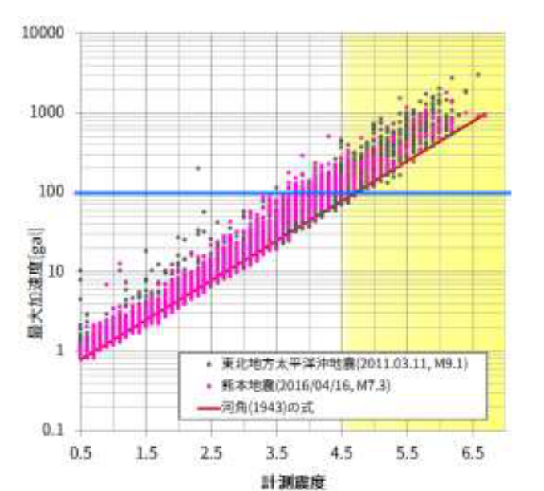{#fig-orig18 fig-alt="最大加速度振幅と計測震度の関係を示す原資料の図18"}

*出典: 気象庁「緊急地震速報の概要や処理手法に関する技術的参考資料」図18（https://www.jma.go.jp/jma/kishou/know/jishin/eew/katsuyou/reference.pdf）を抜粋・トリミングのうえ掲載。気象庁ホームページの利用規約（公共データ利用規約（第1.0版）に準拠）に基づく。*

### 3.2-② PLUM法 — 揺れから揺れへ直接予測

**原理**: **Hoshiba(2013)** の実時間地震動予測理論、**Kodera et al.(2018)** による実装です。「揺れから揺れを直接予測する」手法の代表格。

**2つの大胆な仮定**:

1. **「十分に短い距離では、地震波の減衰は無視できる」**: 距離減衰を考慮しなくてよい
2. **「近傍の観測点で観測された揺れの最大値は、今後その予測地点にも到来する」**: 到来方向を考慮しなくてよい

この2つの仮定により、**震源や到来方向を一切知らずに**、予測地点の揺れの大きさを計算できます。

- **観測地点と予測地点が十分に近い場合**（**予測半径 R=30km 以内**）: この近似が成立
- **観測点密度が高い**ほど、この手法は震源決定に依存しないため安定して精度が保たれ、**都市部に置かれた観測点とも相性が良い**（震源とMによる手法は観測振幅の品質に左右されるのに対し、PLUMは観測実績そのものを評価するだけ）

#### 予測半径 R=30km の意味

- **R が小さすぎても揺れの到来を検出できていないかも**という過小評価リスクになります。
- **R が大きすぎると**、減衰を無視している分、**遠くの値が誇張されて過大評価**になる。
- **現行の値 R=30km** は、観測点密度・猶予時間・過大評価リスクのバランスで最適と考えられる値。実際の運用では、30km以内なら比較的公平になり、この範囲なら PLUM法（観測点のみで）でも必要な精度が得られる。

#### PLUM法の予測手順（イ）

1. 各観測点で、リアルタイム震度の**時間最大値 Irobs** をとる
2. 翠川ほか(1999)の換算式で **Irobs → PGVobs**（最大速度振幅）に変換
3. その地点の**地盤増幅度**で補正し、**S波600m/sの硬質地盤上での PGVobs600** を得る
4. これを再び翠川ほか(1999)の換算式で震度に戻して、**硬質地盤に換算したリアルタイム震度最大値 Irobs600** を得る
5. 予測地点から**半径 R 以内の観測点の Irobs600 の最大値**を **Ir600**（硬質地盤での予測震度）とする
6. **Ir600 をその地点の地盤増幅度で増幅して、地表面の予測震度 Irs** を得る

「**いったん硬質地盤に揃えてから最大値をとる**」という手順の肝: どの観測点の揺れも、地盤条件が違うままだと互いに比較できないので、**600m/s基準という共通の土台に規格化してから比較・選択する**設計です。

**▼原資料 図19 — PLUM法による予測震度の算出手法の模式図**

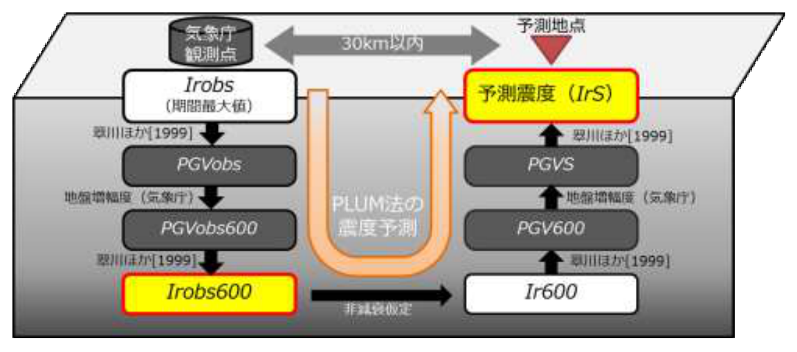{#fig-orig19 fig-alt="PLUM法の予測震度算出手法を示す原資料の図19"}

気象庁観測点で算出されたリアルタイム震度を地盤増幅度で硬質地盤での値に換算し、予測地点から半径R km以内の最大値を予測地点の硬質地盤での値とみなして地表の予測震度を算出する手順の模式図。原資料の説明を要約。

*出典: 気象庁「緊急地震速報の概要や処理手法に関する技術的参考資料」図19（https://www.jma.go.jp/jma/kishou/know/jishin/eew/katsuyou/reference.pdf）を抜粋・トリミングのうえ掲載。気象庁ホームページの利用規約（公共データ利用規約（第1.0版）に準拠）に基づく。*

```{python}
#| label: fig-plum-radius
#| echo: false
#| fig-cap: "PLUM法の概念図: 予測地点（★）を中心とする半径30km内の観測点（●）のうち Irobs600 最大の値を、減衰を仮定せずそのまま予測震度とする"
#| fig-width: 6.2
#| fig-height: 4.4
rng = np.random.default_rng(7)
obs = rng.uniform(-52, 52, size=(28, 2))
R = 30.0
inside = np.hypot(obs[:, 0], obs[:, 1]) <= R
fig, ax = plt.subplots()
ax.add_patch(plt.Circle((0, 0), R, fill=False, color="#c1121f", ls="--", lw=1.6))
ax.scatter(obs[~inside, 0], obs[~inside, 1], s=46, c="#cbd5e1", label="R外（不参加）")
ax.scatter(obs[inside, 0], obs[inside, 1], s=52, c="#1d4ed8", label="R内（Irobs600 参加観測点）")
k = obs[inside][ np.argmax([abs(o[0]) + abs(o[1]) for o in obs[inside]]) ]
ax.plot([k[0], 0], [k[1], 0], color="#e6811b", lw=2.2)
ax.scatter(*k, s=130, c="#e6811b", edgecolors="#333", zorder=5, label="Irobs600 最大の観測点")
ax.annotate("無減衰伝播（仮定）\n→ その値が予測震度 Ir600",
            (k[0] / 2, k[1] / 2), xytext=(k[0] / 2 - 50, k[1] / 2 + 24),
            fontsize=9, color="#b45309",
            arrowprops=dict(arrowstyle="->", color="#e6811b", lw=1.2))
ax.scatter(0, 0, marker="*", s=260, c="#111", zorder=6)
ax.annotate("予測地点", (0, 0), xytext=(2, -7.5), fontsize=10)
ax.text(0, -R - 9, "予測半径 R = 30 km", fontsize=10, color="#c1121f", ha="center")
ax.set_xlim(-58, 58)
ax.set_ylim(-58, 60)
ax.set_aspect("equal")
ax.set_xticks([])
ax.set_yticks([])
ax.set_xlabel("（任意の相対位置，km）")
ax.legend(loc="upper right", fontsize=8.5)
fig.tight_layout()
```

#### 弱みの整理

- **内陸の浅い地震**（震源近傍での急峻な距離減衰が大きい場合）: 過大評価しかねない
- **観測点が少ない地域**: 近くに観測点がなければ、その地域の揺れは予測できない（過小評価）
- それでもPLUM法には「**震源や破壊の成長によらず、揺れを観測した直後から迅速に発表できる**」という強みがあり、運用上はこの利点を優先して併用しています。

#### PLUM法のイベント作成・終了処理（ウ）

単純な最高値の連続予測では「地震ごと」に情報をまとめられません。そこでPLUM法は**イベント識別**を持っています。

- **震度トリガオン**: ある観測点で**リアルタイム震度が閾値以上**になったら「その観測点は揺れあり」と判定し、予測に参加させる
- **震度トリガオフ**: リアルタイム震度が**トリガオフ閾値を一定時間下回った**ら、その観測点を予測から外す
- **PLUMイベント**: 新たにトリガオン観測点が発生したらPLUM法の**新規イベント**を作成。既に存在する空間的に近接したイベントがあれば、そのトリガ観測点を**既存イベントに取り込む**
- **イベント終了**: そのイベントに所属する観測点が**すべてトリガオフ**になったら終了

**（補足）猶予時間の限界**: PLUM法は震源を仮定しないので、「その揺れまであと何秒」という到達時刻を原理的に計算できません。R=30km、伝播速度3km/s なら**最大でも10秒程度**の先行予測という限界が本質的にあります。

---

## 解説 3.3. ハイブリッド処理

### ■ 予測震度のハイブリッド処理

- **震源とMによる手法** と **PLUM法** の両方が、時間的・空間的に**同一のイベント**であると判定できた場合、**両者の予測震度の大きい方を採用**する。
- **理由**: 二つの手法の弱点を、互いの強みが補い合うからです。
  - 震源とMによる手法は、初期データの誤差に弱いが、**遠くの地点まで予測できる**
  - PLUM法は、遠くは届かないが、**近傍の揺れは観測実績ベースで頑強に予測できる**
- **「震源の棄却」処理**は、ハイブリッドとは別に、震源とMによる予測の内部で実施されるもの（解説3.1-④の品質管理処理）という整理。

### ■ PLUM法と震源M手法の同一イベント判定

- PLUM法によるイベントが新たに検知された場合:
  - **既存イベントが存在しない** → 新しいイベントとして発表
  - **既存イベントが存在する** → 同一と判定して既存イベントに取り込まれる
- **同一判定の条件**:
  1. 両手法で閾値以上の震度予測がなされた**予報区に重複がある**場合
  2. またはPLUM法での発表対象予報区内に、震源とM手法による**推定震源に所属する観測点が存在する**場合

---

## 解説 4. 発表処理

### 4.1 予報 と 警報

緊急地震速報には2つのタイプがあり、**「警報」の方が厳しい条件で発信される情報**です。通常は「予報」を待ってから警報が併せて発表されます（警報発表時に同タイミングで予報も出る）。

| | 発表条件（トリガ） | 性格 |
| --- | --- | --- |
| **予報** | 加速度100gal以上（レベル法）、または推定M3.5以上 / 予測最大震度3以上 / 予測長周期階級1以上 | 閾値が低く、情報を広く早く出す |
| **警報** | **2観測点以上**での解析で、**予測最大震度5弱以上**、または **最大予測長周期階級3以上** | 緊急地震速報の本丸。多くの機器や人員に強いアクションを促す |

**警報の特別な条件の解説**:

- **2観測点以上**: 1観測点のみでは信頼性が低いので、**複数観測点による解析の裏付けがある**場合のみ警報に移行
- **最大震度5弱以上**: 直接的な人身被害・物の運搬被害の可能性が現実味を帯びるレベル
- **長周期階級3以上**: 高層ビル・大型構造物でしっかり揺れを感じるレベル
- **発表対象地域（原資料通り）**: 最大震度4以上 または 最大長周期地震動階級3以上が予測される地域に対して発表する（reference.md 4.（１）「警報」および原資料p.21の記載に忠実）。ここで、**発表条件（全国どこかで5弱以上／階級3以上を予測＝トリガ）と、発表対象地域（震度4以上／階級3以上と予測される地域ごとに発表）を区別**して理解すること。なお、気象庁の広報資料等では長周期の対象地域を「階級1以上」と説明する文脈もあるが、本解説は技術資料（令和6年4月11日版）の記載を優先し「階級3以上」とする。
- **観測点数が1地点の間は警報を出さない**: 震源決定やPLUM法の震度予測に使える観測点が1地点のみの間は、誤報リスクが高いため警報を控える
- **M計算に用いる観測点数が3地点未満 かつ 検知から15秒未満**: この場合は**長周期地震動階級予測に基づく警報**は行わない（観測不足のためM決定の信頼性が低くなっているから）
- **震源深さ150km以深**: 震源とMによる手法では震度・長周期階級とも予測しないため警報は出さない（ただしPLUM法で震度予測されるなら警報は出せる）
- **更新（続報）**: それまでに発表した警報の発表時において予測震度が3以下であった地域に対し、新たに**震度5弱以上**が予測された場合に続報が出る（原資料p.21の記載）
- **特別警報との関係（原資料範囲外の制度補足）**: 気象業務法上、緊急地震速報（警報）のうち予測最大震度6弱以上または予測最大長周期地震動階級4が見込まれる地域向けのものは「特別警報」に位置づけられる。本技術資料（reference.md）には特別警報の記載はないため、制度理解のための補足として付記する。

### 4.2 予報の発表条件

- **[1] 観測点の加速度が100gal以上**（＝レベル法発信）
- **[2] 推定M3.5以上、または予測最大震度3以上、または予測長周期階級1以上**

### 4.3 予報の更新条件（表2）

前回の発表時から、次の表にある「有意な変化」とみなせる条件を満たした場合に更新されます：

| 区分 | 緯度・経度 | 深さ | マグニチュード | 最大震度（計測震度） | 最大長周期地震動階級 |
| --- | --- | --- | --- | --- | --- |
| 内陸 | ±0.2度以上 | ±20km 以上 | +0.5以上 or −1.0以上 | +0.5以上 or −1.0以上 | ＋1階級以上 |
| 海域 | ±0.4度以上 | ±40km 以上 | 同上 | 同上 | ＋1階級以上 |

**非対称な条件の意図**: 上がる方向では **+0.5（または＋1階級）という小さな変化でも**情報を更新する一方、下がる方向では **−1.0という大きな変化でない限り**更新しない。これは「揺れの見積もりを下げすぎない／頻繁に発表を乱さない」という情報の安定性を優先した設計です。

### 4.4 予報の終了条件

- [1] 最初の地震波の検出から **M に応じた時間**が経過し、かつ閾値以上のリアルタイム震度が一定時間観測されないとき
- [2] 一定時間（**600秒**）が経過したとき

### 4.5 キャンセル報

- **地震以外**で予報・警報が誤って発表されたと判断された場合、**キャンセル報**で取り消しを告知する
- **「予報」の自動キャンセル条件**: 所定の時間内に **2地点目の観測点が検知できない**場合は自動的にキャンセル
- **島嶼部の例外**: 島嶼部では観測点が限られ、2地点目が物理的に検知しづらい。そこで「**一定以上の揺れが続いたと判断できた場合**」は、2地点目の検知なしでもキャンセルをしない
- なお、警報そのものをキャンセルする条件については本資料では特に触れられておらず、言及されているのは予報の自動キャンセルに関する部分です。

### 4.6 PLUM法のみで情報発表する場合の震源要素

PLUM法では震源が推定されません。しかし発表の形上は「**どこかの震源**」の記載なども必要で、仮定の値を置く運用になっています:

- **緯度経度**: PLUM法で**最初に震度トリガオン条件を満たした観測点**の緯度経度
- **深さ**: **10km（固定）**
- **M**: **1.0（固定）**

これらは「推定震源」ではなく、あくまで**電文のフォーマットを満たすためのプレースホルダ（仮定震源要素）**です。

### 4.7 地域単位での発表と、発表単位の整合性

- **予測震度の計算**は全国約**4,400地点**、**予測長周期地震動階級の計算**は全国約**670地点**について、地震情報で発表している震度観測点ごとに行う
- **ただし、予報・警報は「地域の単位」で発表**する
- 地域内に複数の観測点がある場合、**震度・長周期階級は「最も大きく予測された地点」の値**を、**主要動到達予測時刻は「最も早い予測時刻」の値**を、それぞれ地域の代表として採用する。つまり、常に最も悪い（大きな揺れ／早い到達）値が代表になる**保守的な取り方**をしています
- **影響**: このため、予測最大震度と主要動到達予測時刻が**同一の場所で推定された結果にならない場合がある**（最大震度の地点と、到達時刻の地点が別々になることがある）点に注意が必要です。

### 4.8 電文（表3・表4）— 精度の差を「電文の表現」にまで表す思想

**表3の読み方**: 震源決定手法によって、同じ「緊急地震速報（予報）」でも**表現の精粗**が電文上で変わります。

| パターン | 手法 | 表現 |
| --- | --- | --- |
| **パターン1**（電文種別番号35） | レベル法 | **最大震度予測のみ（震度5弱程度以上）**。M・位置・時刻はなし |
| **パターン2**（36） | IPF法 1〜2地点処理・仮定震源要素 | **M○○程度以上 / 震度○○程度以上 / ○○時○○分○○秒頃以降** |
| **パターン3**（37） | IPF法3地点以上・着未着法・EPOS | **M○○程度 / 震度○○から○○ / ○○時○○分○○秒頃以降**（緯度経度・深さ含む。予測震度は点震源想定を下限、断層長考慮を上限とする幅表現） |

- **なぜこの差があるか**: 電文種別番号（35/36/37）は「**震源の推定精度の区分**」をコード化したものです。
- **パターン1**は、1観測点だけのレベル法では**震源の位置すら推定できない**ため、「震度5弱程度以上」という最大震度予測のみを表現する
- **パターン2**では、震源は何とか推定されたが1〜2地点の粗いものなので、震度は**下限だけ**を示し「○○程度以上」とする
- **パターン3**では3地点以上の高精度測定があり、幅を付けた「○○から○○」という表現で**上下限の両取り**表現が可能になる
- **PLUM法のみで発信する場合の震源要素**はパターン2（仮定震源要素）に準拠
- **1観測点での震源推定結果や1観測点でのPLUM法予測結果によって発表される場合**、誤報防止のため電文中に予測震度や予測長周期地震動階級を記載しない（reference.md 4.（２）電文の記載）。

**表4の読み方**: 緊急地震速報関連の電文形式固有のID一覧です。

| 種類 | コード電文 | XML電文 |
| --- | --- | --- |
| 緊急地震速報（警報） | ｷﾝｷﾕｳｼﾞｼﾝ13 | VXSE43 |
| 緊急地震速報（予報） | ﾅｳｷﾔｽﾄ13 | VXSE44 |
| 緊急地震速報（地震動予報） | ― | VXSE45 |
| リアルタイム震度電文 | ﾅｳｷﾔｽﾄﾘｱﾙ3 | VXSE47 |
| 緊急地震速報（警報）（かな漢字） | ｷﾝｷﾕｳｼﾞｼﾝ 4 | ― |
| 緊急地震速報（予報）（かな漢字） | ﾅｳｷﾔｽﾄ4 | ― |

特に注意する点:

- **「地震動予報」はXML形式のみでコード電文が存在しない**新形式
- 新形式の予報では、既存予報に加えて**「Head部の警報事項・長周期地震動階級の予測値・最大予測階級の変化」**の3要素が追加される

---

## 検証ノート — 式を Python で回してみる

上の（1）〜（6）の数式ストリームはそのまま計算機で実行できます。ここでは**司・翠川(1999)式 + 翠川ほか(1999)換算式**の骨格を実装し、距離減衰の挙動と一点での震度計算例を示します（地盤増幅度は仮の値）。

```{python}
#| label: pgv-intensity-example
#| echo: true
#| output: asis
# 初期化チャンクで pgv600 / seismic_intensity を定義済み
Mw, D, A_Rv700 = 6.5, 10.0, 2.0
rows = ["| 最短距離 x (km) | PGV600 (cm/s) | PGV700 (cm/s) | 地表 PGVs (cm/s) | 計測震度 |",
        "| --- | --- | --- | --- | --- |"]
for x in (10, 30, 100, 300):
    v600 = pgv600(Mw, D, x)
    v700 = (600.0 / 700.0) ** 0.66 * v600   # 600→700 換算（＝0.90倍）
    v_surface = A_Rv700 * v700              # 仮の速度増幅度で地表へ
    I = seismic_intensity(v_surface)
    rows.append(f"| {x} | {v600:.2f} | {v700:.2f} | {v_surface:.2f} | {I:.2f} |")
print("\n".join(rows))
```

続けて、距離減衰そのものを図にします（断層球面からの最短距離による差を見るため、断層球の寄与 `0.0028 × 10^(0.50Mw)` もそのまま反映）。

```{python}
#| label: fig-pgv600-attenuation
#| fig-cap: "司・翠川(1999)式によるPGV600の距離減衰（深さ D = 10 km）"
#| fig-width: 7
#| fig-height: 4.2
#| echo: true
import os
os.environ["MPLBACKEND"] = "module://matplotlib_inline.backend_inline"
import matplotlib as mpl
mpl.rcParams["font.family"] = ["Meiryo"]
import matplotlib.pyplot as plt

x = np.linspace(3, 400, 500)
fig, ax = plt.subplots()
for Mw in (5.0, 6.0, 7.0, 8.0):
    ax.plot(x, pgv600(Mw, 10.0, x), label=f"Mw={Mw}")
ax.set_xscale("log")
ax.set_yscale("log")
ax.set_xlabel("断層球面からの最短距離 x (km)")
ax.set_ylabel("PGV600 (cm/s)")
ax.grid(True, which="both", alpha=0.3)
ax.legend()
plt.show()
```

- **読みどころ**: Mwが大きくなると曲線全体が上がるほか、**近距離側が急に膨らむ**のは距離項の断層球相当分 `0.0028 × 10^(0.50Mw)` が効いているためで、「破壊域が広がる＝震源近傍でも大揺れになる」という式の設計思想がそのまま見えます。

---

## 総まとめ — 全体の流れをもう一度

1. **観測点側**: P波がトリガ → 1秒で検測時刻（遡り検測）＋主成分分析（P波の縦波性 → 方位）＋B-Δ法（エンベロープの B → 距離）＋8種のノイズ識別 → 毎秒送信。常時はリアルタイム震度も逐次算出。
2. **中枢側（震源・M）**: IPF法（パーティクルフィルタで全データ統合）＋着未着法（未着観測点も情報）＋EPOS（S波到達後の正確版）→ 震源。Mは、**P波M →（固定M）→ 全相M** とS波理論到達時刻に応じて切替。**近傍M**で不適切な震源を棄却。
3. **中枢側（震度）**: 震源とMから、**Mw換算 → 宇津相似則（断層長 L/2 の球） → 司・翠川(1999)距離減衰 → 地盤増幅 → 計測震度** の5ステップ。長周期階級は**Sva距離減衰式 + siteFactor（A/B）** で1.6〜7.8秒帯を0.2秒ごとに評価。
4. **中枢側（揺れから揺れ）**: **レベル法**（100gal超で震度5弱相当の最速発表）、**PLUM法**（半径30km内の最大値を無減衰伝播する仮定で頑強に予測）を補助的に使用。
5. **ハイブリッド**: 震源とMによる手法とPLUM法の結果を同一イベントと判別できたら**大きい方の予測震度を採用**し、品質管理（近傍M）で不適切な震源は棄却する。
6. **発表**: **予報**（M3.5 / 震度3 / 長周期階級1 で開始）と**警報**（2観測点以上 + 震度5弱以上 or 長周期階級3以上）の条件が満たされれば発表し、その後**更新**（表2の変化条件）、**終了**（Mに応じた時間経過や600秒）で処理を閉じる。

---

## 用語ミニ集

- **gal**: 加速度の単位。1 gal ＝ 1 cm/s²（※重力加速度 g ≒ 980 gal）。
- **計測震度**: 数値計算で求めた震度（現在の気象庁の震度）。整数階級に丸めたものが気象庁の「震度」。
- **Irobs600 / Ir600**: 硬質地盤（600m/s）基準に換算したリアルタイム震度の最大値／PLUM法における硬質地盤上の予測震度。地表の予測震度は Ir600 を地盤増幅度で増幅した Irs として得る。
- **基準基盤(600m/s)** / **工学的基盤(700m/s)**: 観測地点のS波速度で定義される仮想の硬質地盤。前者が「比較基準」、後者が「工学的・設計の基準」。600→700 の間は `(600/700)^0.66 ≒ 0.90` の係数で変換。
- **A_Rv / A_Vs**: 速度増幅度／地下30mまでの平均S波速度。地盤が軟弱（A_Vsが小さい）ほど増幅が大きい。
- **Sva**: 絶対速度応答スペクトル。長周期地震動の強さ指標で、長周期階級の判定に用いられる。
- **テリトリー法**: 検測時刻の分布に基づいて観測点を区分し、震源が存在しうる領域を限定する手法。横田ほか(2002)・中村(2007)の考え方がIPF法に取り入れられている。
- **走時表**: ある速度構造で、深さ・距離ごとの波の到達時間を表形式にまとめたもの（JMA2001）。
- **P波M・全相M**: P波部分の振幅から推定するM／S波以降（地震波全体）の振幅から推定するM。
- **棄却**: 不適切な推定震源（近傍Mで怪しい震源・M）を後続の計算から排除すること。
- **トリガ**: 観測点で地動がノイズレベルの定数倍を超えた状態。その後の処理が本格開始される。
- **着・未着**: ある観測点に地震波が到達している／まだ到達していないという状態区別。着未着法では未着状態も情報として使う。
